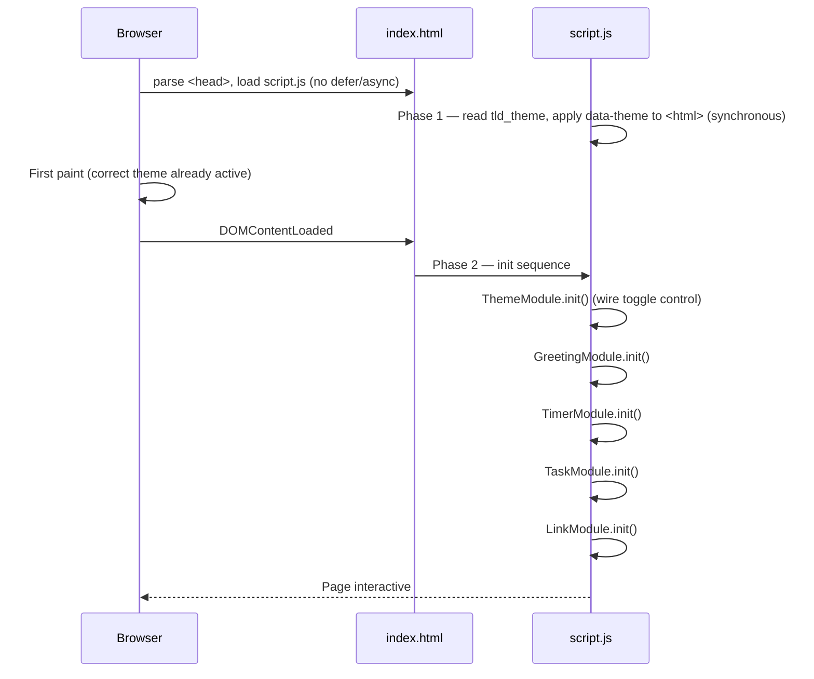
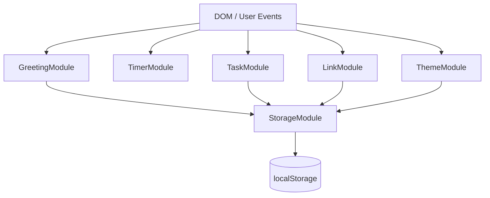
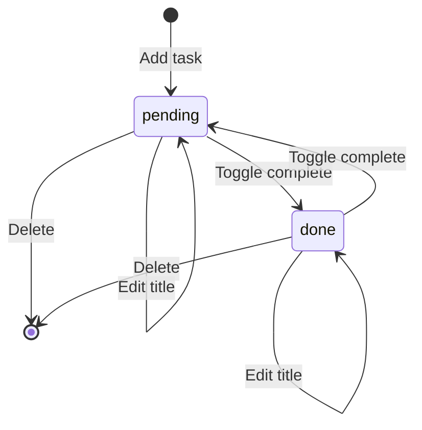

# Design Document: To-Do List Life Dashboard

## Overview

The To-Do List Life Dashboard is a self-contained single-page application delivered as a static `index.html` file with one accompanying CSS file (`css/style.css`) and one JavaScript file (`js/script.js`). It runs entirely in the browser with no build step, no backend, and no external dependencies beyond what is natively available in every modern browser.

The application combines five features on a single page:

1. **Greeting** — live clock (HH:MM:SS), date, time-of-day salutation, and a customisable user name
2. **Focus Timer** — a 25-minute Pomodoro-style countdown with start / stop / reset controls
3. **To-Do List** — CRUD task management with duplicate prevention
4. **Quick Links** — a saved-URL panel that opens links in a new tab
5. **Theme Toggle** — instant light / dark switch with flash-free persistence

All user data is stored in the browser's `localStorage` API. The design ensures that every state change is reflected on-screen within 100 ms and that corrupted storage data is handled gracefully without crashing the page.

---

## Architecture

### Structural Pattern

The application uses a **module-based vanilla JS architecture** without a framework. The single `js/script.js` file is organised as a set of immediately-invoked or explicitly-initialised modules (plain objects / closures), each owning its own DOM queries, state, and localStorage interaction.

This avoids global variable pollution, keeps each feature independently testable, and makes the code navigable without a bundler or type system.

### Initialization Sequence

Startup is split into two phases to eliminate the flash of wrong theme.

**Phase 1 — synchronous, top of `script.js` (before any `DOMContentLoaded` listener):**

`js/script.js` is loaded via a `<script>` tag placed in `<head>` **without** `defer` or `async`. At the very top of the file, an immediately-executing block reads `localStorage.getItem("tld_theme")`, parses it with `JSON.parse`, and sets `document.documentElement.dataset.theme` synchronously. This runs before the browser paints any content, so the correct theme variables are in place on the very first paint.

**Phase 2 — inside `DOMContentLoaded`:**

All module initialisation runs after the DOM is ready:

1. **ThemeModule.init()** — wires up the toggle control (theme is already applied).
2. **GreetingModule.init()** — reads stored `User_Name`, starts the 1-second clock tick.
3. **TimerModule.init()** — renders 25:00 and wires up controls.
4. **TaskModule.init()** — loads tasks from localStorage, renders the list.
5. **LinkModule.init()** — loads quick links from localStorage, renders the panel.



### State Management

Each module owns its private state. There is no shared mutable global store. Modules communicate only through direct DOM events when needed (e.g., clicking a button triggers a handler within the owning module). localStorage is the only cross-session persistence layer.



---

## Components and Interfaces

### 1. StorageModule

Central wrapper around `localStorage` that provides safe read/write with error handling.

```js
StorageModule = {
  get(key)        // → parsed value | null (returns null on parse error)
  set(key, value) // → boolean (true = success, false = QuotaExceededError or other)
  remove(key)     // → void
}
```

All other modules call `StorageModule.get` / `StorageModule.set` rather than calling `localStorage` directly. This ensures corrupted data never propagates as an unhandled exception.

**Storage keys (constants):**

| Constant | Key string | Data type |
|---|---|---|
| `KEYS.USER_NAME` | `"tld_userName"` | `string` |
| `KEYS.TASKS` | `"tld_tasks"` | `Task[]` |
| `KEYS.LINKS` | `"tld_links"` | `QuickLink[]` |
| `KEYS.THEME` | `"tld_theme"` | `"light" \| "dark"` |

---

### 2. GreetingModule

Manages the greeting, live clock, date display, and name input.

**Public interface:**
```js
GreetingModule = {
  init()                       // attach DOM refs, load name, start tick
  _tick()                      // updates clock + greeting every second via setInterval
  _getGreetingPhrase(hour)     // pure fn: number → "Good Morning" | ... 
  _formatTime(date)            // pure fn: Date → "HH:MM:SS"
  _formatDate(date)            // pure fn: Date → "DayName, MonthName DD, YYYY"
  _handleNameSubmit(event)     // validates + saves name, re-renders greeting
}
```

**Greeting logic:**

| Hour range | Greeting |
|---|---|
| 5–11 | Good Morning |
| 12–17 | Good Afternoon |
| 18–21 | Good Evening |
| 22–23, 0–4 | Good Night |

---

### 3. TimerModule

Manages the 25-minute countdown timer.

**Public interface:**
```js
TimerModule = {
  init()        // render initial state, wire controls
  _start()      // begins countdown via setInterval (no-op if already running)
  _stop()       // pauses countdown (clears interval, preserves remaining time)
  _reset()      // stops + resets remainingSeconds to 1500
  _tick()       // decrements remainingSeconds, updates display, handles 00:00
  _render()     // formats remainingSeconds → MM:SS, updates DOM + control states
  _notify()     // shows on-page end notification when timer reaches 00:00
}
```

**State:**
- `remainingSeconds: number` (starts at 1500)
- `intervalId: number | null` (non-null while counting)
- `isRunning: boolean`

**Control state table:**

| Timer state | Start enabled | Stop enabled | Reset enabled |
|---|---|---|---|
| Stopped / paused | ✓ | ✗ | ✓ |
| Running | ✗ | ✓ | ✓ |

---

### 4. TaskModule

Manages the full CRUD lifecycle for tasks.

**Public interface:**
```js
TaskModule = {
  init()                          // load from storage, render list
  _addTask(title)                 // validate, create Task, save, render
  _editTask(id, newTitle)         // validate, update in place, save, render
  _toggleTask(id)                 // flip pending ↔ done, save, render
  _deleteTask(id)                 // remove by id, save, render
  _isDuplicate(title, excludeId)  // pure fn: case-insensitive match check
  _validateTitle(title)           // pure fn: returns error string or null
  _saveToStorage()                // wraps StorageModule.set, handles failure
  _render()                       // full re-render of task list DOM
  _renderTask(task)               // returns a DOM element for one task
}
```

**Task lifecycle:**



---

### 5. LinkModule

Manages quick links.

**Public interface:**
```js
LinkModule = {
  init()                    // load from storage, render panel
  _addLink(label, url)      // validate, create QuickLink, save, render
  _deleteLink(id)           // remove by id, save, render
  _isDuplicateUrl(url)      // pure fn: case-insensitive URL match
  _validateLink(label, url) // pure fn: returns { labelError, urlError } | null
  _saveToStorage()          // wraps StorageModule.set, handles failure
  _render()                 // re-render links panel DOM
}
```

---

### 6. ThemeModule

Manages light / dark theme.

**Public interface:**
```js
ThemeModule = {
  init()        // wire up the toggle control (theme already applied by Phase 1)
  _toggle()     // flip current theme, save, update toggle control label
  _apply(theme) // adds/removes data-theme attribute on <html> element
}
```

Theme is applied via a `data-theme="dark"` attribute on the `<html>` element. CSS custom properties (`--color-bg`, `--color-text`, etc.) are defined for both themes. No JavaScript inline styles are used for theming.

**Phase 1 inline block (top of `script.js`, before `DOMContentLoaded`):**

```js
// Immediately-executing theme bootstrap — runs synchronously before first paint
(function () {
  try {
    var theme = JSON.parse(localStorage.getItem("tld_theme"));
    if (theme === "dark" || theme === "light") {
      document.documentElement.dataset.theme = theme;
    }
  } catch (e) { /* corrupted value — leave default */ }
})();
```

`ThemeModule.init()` (called inside `DOMContentLoaded`) only wires the toggle button; it does **not** re-apply the theme, as that has already been done.

---

## Data Models

### Task

```js
/**
 * @typedef {Object} Task
 * @property {string} id        - Unique identifier (crypto.randomUUID() or Date.now().toString())
 * @property {string} title     - Task description, 1–255 characters (trimmed)
 * @property {"pending"|"done"} status - Task completion state
 * @property {number} createdAt - Unix timestamp (ms) of creation
 */
```

**Constraints enforced at runtime:**
- `title` must be non-empty after trim, max 255 characters
- `title` must not match any other task's `title` (case-insensitive)
- `status` must be `"pending"` or `"done"`

### QuickLink

```js
/**
 * @typedef {Object} QuickLink
 * @property {string} id    - Unique identifier
 * @property {string} label - Display label, 1–50 characters
 * @property {string} url   - Full URL beginning with http:// or https://, max 2048 chars
 */
```

**Constraints enforced at runtime:**
- `label` must be non-empty, max 50 characters
- `url` must start with `http://` or `https://`, max 2048 characters
- `url` must not be a case-insensitive duplicate of an existing QuickLink's `url`

### localStorage Schema

```js
// Tasks: stored as JSON array
localStorage.setItem("tld_tasks", JSON.stringify(Task[]));

// Quick Links: stored as JSON array
localStorage.setItem("tld_links", JSON.stringify(QuickLink[]));

// User Name: stored as JSON string
localStorage.setItem("tld_userName", JSON.stringify(string));

// Theme: stored as JSON string
localStorage.setItem("tld_theme", JSON.stringify("light" | "dark"));
```

---

## Correctness Properties

*A property is a characteristic or behavior that should hold true across all valid executions of a system — essentially, a formal statement about what the system should do. Properties serve as the bridge between human-readable specifications and machine-verifiable correctness guarantees.*

### Property 1: Greeting phrase covers every hour of the day

*For any* integer hour in [0, 23], `_getGreetingPhrase(hour)` SHALL return exactly one of "Good Morning", "Good Afternoon", "Good Evening", or "Good Night" — the ranges are non-overlapping and exhaustive.

**Validates: Requirements 1.3, 1.4, 1.5, 1.6**

---

### Property 2: Clock formatting is always valid HH:MM:SS

*For any* `Date` object, `_formatTime(date)` SHALL return a string matching the pattern `/^\d{2}:\d{2}:\d{2}$/` where the hour component is in [00, 23], minutes in [00, 59], and seconds in [00, 59].

**Validates: Requirements 1.1**

---

### Property 3: Date formatting produces a well-formed string

*For any* `Date` object, `_formatDate(date)` SHALL return a string of the form "DayName, MonthName DD, YYYY" where DayName is a valid English day name, MonthName is a valid English month name, DD is a zero-padded or unpadded day in [1, 31], and YYYY is a four-digit year.

**Validates: Requirements 1.2**

---

### Property 4: Valid task titles are accepted and stored

*For any* non-empty string of 1–255 characters (after trim) that is not a case-insensitive duplicate of an existing task title, calling `_addTask(title)` SHALL increase the task list length by exactly 1, and `StorageModule.get(KEYS.TASKS)` SHALL contain an entry with that trimmed title.

**Validates: Requirements 3.2, 3.5, 8.2**

---

### Property 5: Whitespace-only and empty task titles are rejected

*For any* string composed entirely of whitespace characters (including the empty string), `_validateTitle(title)` SHALL return a non-null error string, and calling `_addTask(title)` SHALL leave the task list length unchanged.

**Validates: Requirements 3.3**

---

### Property 6: Task title length boundary is enforced

*For any* string whose trimmed length exceeds 255 characters, `_validateTitle(title)` SHALL return a non-null error string, and calling `_addTask(title)` SHALL leave the task list length unchanged.

**Validates: Requirements 3.4**

---

### Property 7: Duplicate task titles are rejected (case-insensitive)

*For any* existing task list and any new title whose case-insensitive trim matches an existing task's title, `_isDuplicate(title, null)` SHALL return `true` and `_addTask(title)` SHALL leave the task list unchanged.

**Validates: Requirements 4.1**

---

### Property 8: Task completion toggle is its own inverse (round-trip)

*For any* task with status `"pending"`, toggling it twice via `_toggleTask(id)` SHALL return the task to status `"pending"`, and the task list length SHALL be unchanged throughout.

**Validates: Requirements 5.8, 5.9**

---

### Property 9: Task edit preserves identity, updates title

*For any* task and any valid (non-empty, non-duplicate, ≤255-char) new title, calling `_editTask(id, newTitle)` SHALL leave the task count unchanged, the task's `id` and `createdAt` unchanged, and the task's `title` equal to the trimmed new title.

**Validates: Requirements 5.3**

---

### Property 10: Valid quick links are accepted and stored

*For any* label of 1–50 characters and URL beginning with `http://` or `https://` (max 2048 chars) that is not a case-insensitive duplicate of an existing link URL, calling `_addLink(label, url)` SHALL increase the link list length by exactly 1, and `StorageModule.get(KEYS.LINKS)` SHALL contain an entry with that label and URL.

**Validates: Requirements 6.2, 6.9, 8.3**

---

### Property 11: Duplicate quick link URLs are rejected (case-insensitive)

*For any* existing link list and any new URL whose case-insensitive value matches an existing QuickLink's URL, `_isDuplicateUrl(url)` SHALL return `true` and `_addLink(label, url)` SHALL leave the link list unchanged.

**Validates: Requirements 6.5**

---

### Property 12: Data serialization round-trip preserves values

*For any* array of `Task` objects or `QuickLink` objects, serializing with `JSON.stringify` and immediately deserializing with `JSON.parse` SHALL produce an array equal in structure and values to the original (same length, same field values for each element).

**Validates: Requirements 8.2, 8.3**

---

### Property 13: Theme toggle is its own inverse (round-trip)

*For any* initial theme (`"light"` or `"dark"`), toggling twice via `ThemeModule._toggle()` SHALL return to the original theme, and `StorageModule.get(KEYS.THEME)` SHALL equal the original theme value.

**Validates: Requirements 7.1, 7.2, 7.5**

---

### Property 14: StorageModule.get returns null on corrupted data

*For any* localStorage key whose raw value is not valid JSON, `StorageModule.get(key)` SHALL return `null` rather than throwing an exception.

**Validates: Requirements 8.6**

---

## Error Handling

### Corrupted localStorage Data

When `StorageModule.get(key)` parses a value and encounters a JSON error, it catches the exception silently and returns `null`. Each module interprets a `null` result as "no saved data" and falls back to its default empty state (empty task list, empty links panel, `"light"` theme, no stored name). No unhandled error is thrown to the global scope.

### localStorage Write Failures (QuotaExceededError)

`StorageModule.set(key, value)` wraps `localStorage.setItem` in a try/catch. If writing fails, it returns `false`. The calling module (TaskModule, LinkModule, ThemeModule, GreetingModule) checks this return value and:

- For `TaskModule` / `LinkModule`: reverts the in-memory array to its pre-operation snapshot and displays an error message to the user ("Your change could not be saved. Storage may be full.").
- For `ThemeModule` / `GreetingModule`: silently ignores the write failure since the visual state is already correct for the current session.

### Input Validation Errors

All validation is client-side, synchronous, and happens before any state mutation:

| Error condition | Displayed feedback location |
|---|---|
| Empty / whitespace task title | Below the task input field |
| Task title > 255 characters | Below the task input field |
| Duplicate task title | Below the task input field |
| Empty user name submitted | Clears stored name, reverts greeting (not an error, by design) |
| User name > 50 characters | Below the name input field |
| Empty quick link label | Below the link form |
| Invalid quick link URL | Below the link form |
| Duplicate quick link URL | Below the link form |

Error messages are cleared when the user modifies the relevant input field (via `input` event listener).

### Timer Edge Cases

- If `_start()` is called while `isRunning === true`, it returns immediately without creating a second interval.
- If `_stop()` is called while `isRunning === false`, it returns immediately.
- If `_reset()` is called while `isRunning === true`, it clears the interval before resetting state.

---

## Testing Strategy

> **Note:** This project is a vanilla JS single-page application with no build tools or test runner configured. The requirements explicitly state no installation or build step is permitted. All testing is manual in-browser verification.

### Manual Test Areas

**Unit-level (pure functions):**

| Function | What to verify |
|---|---|
| `_getGreetingPhrase(hour)` | All 24 hours map to correct phrase |
| `_formatTime(date)` | Midnight (00:00:00), noon (12:00:00), 23:59:59 |
| `_formatDate(date)` | Jan 1, Dec 31, leap day (Feb 29) |
| `_validateTitle(title)` | Empty string, whitespace-only, 255 chars, 256 chars |
| `_isDuplicate(title)` | Case variants ("TASK" vs "task"), trimmed whitespace |
| `_validateLink(label, url)` | Valid, missing label, missing URL, ftp:// URL, http URL |
| `_isDuplicateUrl(url)` | Same URL different case (HTTP vs http) |
| `StorageModule.get(key)` | Valid JSON, invalid JSON, missing key |

**Integration-level (browser-verified):**

| Scenario | Expected result |
|---|---|
| Load page with empty localStorage | Default state: no tasks, no links, light theme, no name |
| Add task → reload page | Task persists |
| Toggle task done → reload | Status persists |
| Edit task to duplicate name | Error shown, original title retained |
| Add quick link → reload | Link persists |
| Toggle theme → reload | Correct theme applied on load with no flash |
| Fill localStorage quota | Error message shown, in-memory state reverted |
| Corrupt localStorage value manually | Default empty state rendered, no crash |
| Start timer → reaches 00:00 | Notification shown, start enabled, stop disabled |
| Start timer → stop → start | Countdown resumes from paused position |
| Start timer → reset | Returns to 25:00, start enabled, stop disabled |

**Cross-browser:**

Run the integration scenarios above in Chrome, Firefox, Edge, and Safari (latest stable releases). Pay particular attention to:

- `Date` formatting (month/day names must be English in all browsers — use explicit English arrays rather than `toLocaleDateString` to guarantee consistent output)
- `crypto.randomUUID()` availability (Safari 15.4+; fall back to `Date.now() + Math.random()` if needed)
- `localStorage` quota differences between browsers
